<div align="center">


<a href="https://github.com/amaliasr">
  
</a>

<p>
  <a href="https://github.com/amaliasr/HelloAmalia"></a>
  &nbsp;
  
</p>

</div>


## ☁️ About Me

```js
const amalia = {
  role:       "Product Manager",
  basedIn:    "Indonesia 🇮🇩",
  superpower: "turning messy problems into clear, lovable products",
  loves:      ["user research", "data-driven decisions", "shipping", "pastel everything ☁️"],
  motto:      "Fall in love with the problem, not the solution ♡",
  askMeAbout: ["product strategy", "discovery", "prioritization", "UX"],
};
```

- 🎯 Menjembatani **user, bisnis, dan engineering** untuk membangun produk yang berarti
- 🌸 Selalu mencari cara agar produk terasa lebih simpel, cepat, dan menyenangkan
- 🌱 Sedang mendalami **product analytics** dan **AI-powered products**
- 💬 Mau ngobrol soal produk, startup, atau ide baru? Yuk sapa aku!




## 🧸 Toolkit

<div align="center">


<br/><br/>


</div>


## 📈 GitHub Stats

<div align="center">


</div>


## 💌 Send Some Love

<div align="center">

<a href="https://github.com/amaliasr/HelloAmalia">
  
</a>

<sub>Suka profil ini? Klik tombolnya, lalu tekan <b>⭐ Star</b> di kanan atas — setiap Star menambah satu ♡ ke hitungan di atas.</sub>

</div>


<div align="center">

### 🌸 Let's Connect

<a href="https://github.com/amaliasr"></a>

<br/><br/>


</div>
